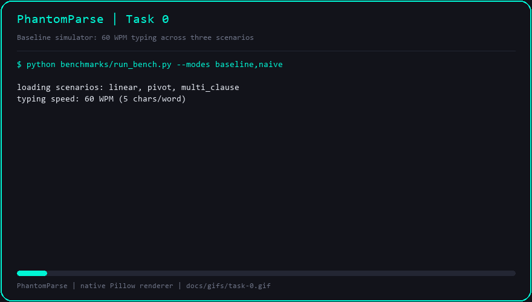

# Task 0 — Scaffolding, Telemetry, and Baseline Harness

## Objective

Stand up the PhantomParse repository so that every later task has a reproducible
measurement rig: deterministic typing input, a latency model, a native GIF
recorder for pull-request evidence, and a layered configuration loader shared by
the daemon, overlay, and benchmarks.

## What landed

| Area | Module | Purpose |
| --- | --- | --- |
| Packaging | `pyproject.toml`, `requirements.txt` | Python 3.11+ project metadata, `phantomparse` console entry point, `nlp` / `hotkey` / `visuals` / `dev` extras |
| Config | `src/phantomparse/config.py`, `config/default_config.yaml` | Bundled → user (`~/.config/phantomparse/config.yaml`) → explicit-path precedence with scalar coercion |
| Input model | `benchmarks/keystroke_simulator.py` | Virtual-clock typing at five characters per word; linear, mid-sentence pivot, and multi-clause scenarios |
| Telemetry | `benchmarks/run_bench.py` | Baseline and naive-speculation modes, Time to First Token (TTFT), post-Enter retrieval, wasted tokens, `tracemalloc` peak memory, Markdown report |
| Evidence | `benchmarks/gif_recorder.py` | Pillow-only animated GIF renderer (no ffmpeg or ImageMagick) |
| Tests | `tests/test_config.py`, `tests/test_keystroke_simulator.py` | 23 tests over precedence, coercion, timeline arithmetic, and event replay |

## Demo



Regenerate with `python benchmarks/gif_recorder.py --task 0`.

## Headline numbers

Typing speed 60 WPM, TTL 30 s, similarity threshold 0.75, prefill 240 tokens/s.

| Mode | Mean TTFT (ms) | Mean Post-Enter Retrieval (ms) | Wasted LLM Tokens | Mean Waste (%) | TTFT Reduction vs Baseline |
| --- | ---: | ---: | ---: | ---: | ---: |
| Baseline | 795.0 | 472.5 | 0 | 0.0 | n/a |
| Naive Speculation | 183.0 | 25.0 | 10 | 13.9 | 77.0% |

Naive speculation already wins on latency but pays for it on the pivot scenario:
10 tokens (41.7% of that prompt) are prefilled against context the user erased.
Task 3 replaces this with late-bound verification so the same latency win ships
with zero waste.

## Verification gates

```text
$ python -m pytest tests/ -q
.......................                                                  [100%]
23 passed in 0.32s

$ python -m flake8 --jobs 1 src/ tests/ benchmarks/
(no output)

$ python benchmarks/run_bench.py
(renders the Markdown tables above)
```

## Commits

| Commit | Message |
| --- | --- |
| `d188497` | `feat: scaffold project metadata and layered configuration loader` |
| `0e98ea4` | `feat: add deterministic 60 WPM keystroke simulator with pivot scenario` |
| `4ed8577` | `bench: add baseline and naive speculation harness with native GIF recorder` |
| `079e44f` | `test: cover keystroke simulator and configuration loader` |

## Notes and deviations

- Only Python 3.10.11 is available on this machine, so the source is written to
  run on 3.10 while declaring `requires-python = ">=3.11"`. No 3.11-only syntax
  is used.
- Peak daemon memory reads 0.00 MB because Task 0 has no staging allocation yet;
  it becomes meaningful once the ring buffer exists in Task 3.
- `.gitignore` uses `/PhantomParse/` (leading slash) because Windows matches
  paths case-insensitively and the bare pattern also swallowed `src/phantomparse`.
