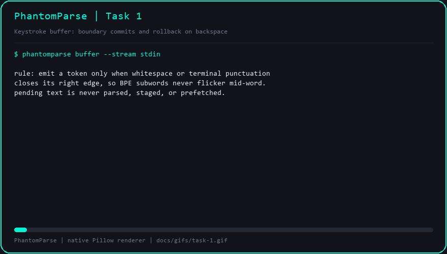

# Task 1 — Real-Time Keystroke Streamer & Word-Boundary Buffer

## Objective

Turn a raw character stream into a stream of **stable orthographic tokens**.
Nothing downstream should ever see a half-typed word.

## The problem this solves

Byte-Pair Encoding (BPE) tokenisers split words into subword units that depend on
the *whole* word. Typing `paym` may tokenise as `pay` + `m`, while `payment`
tokenises as `payment` or `pay` + `ment`. If a speculative pipeline forwards
every keystroke, it prefills context for subwords that will never exist and must
be thrown away. The buffer therefore holds characters until a right boundary is
confirmed, and only then emits a `CommitEvent`.

## Implementation

`src/phantomparse/buffer.py`

| Element | Behaviour |
| --- | --- |
| `CommitEvent(token, char_index, token_index, boundary)` | Emitted when whitespace or terminal punctuation (`. , ; : ! ?`) closes a token |
| `KeystrokeBuffer.feed_char` | Appends to the raw stream; commits on a boundary, otherwise leaves the fragment pending |
| `KeystrokeBuffer.feed_text` | Convenience wrapper returning every event a run of characters produced |
| `KeystrokeBuffer.flush` | Commits the trailing fragment, mirroring the Enter key |
| `RollbackEvent(char_index, token_index, removed)` | Emitted when a deletion reaches into a committed token |
| `KeystrokeBuffer.feed_backspace` | Shrinks pending text; on hitting a committed token, pops it and reopens it as pending |

Invariants covered by the suite:

- Whitespace never commits an empty token.
- Apostrophes and hyphens stay inside a word (`don't`, `late-bound`).
- `char_index` is the offset of the token's first character in the raw stream.
- `token_index` is dense and monotonically increasing; a rollback reports the
  index the invalidated token used to hold, so a Key-Value (KV) cache can
  truncate to `token_index` and drop everything after it.
- Retyping a rolled-back word commits at the same `token_index` and
  `char_index`.
- Pending text is always a suffix of the raw stream, including after edits.

## Demo



Regenerate with `python benchmarks/gif_recorder.py --task 1`.

The animation replays the mid-sentence pivot: tokens commit at boundaries, the
400 ms pause commits nothing, every backspace that crosses a boundary prints
`ROLLBACK token_index=... removed=...`, and the retyped clause commits cleanly.

## Verification gates

```text
$ python -m pytest tests/ -q
........................................                                 [100%]
40 passed in 0.38s

$ python -m flake8 --jobs 1 src/ tests/ benchmarks/
(no output)

$ python benchmarks/run_bench.py
(renders the Baseline / Naive Speculation tables; unchanged by this task)
```

## Commits

| Commit | Message |
| --- | --- |
| `7af012a` | `feat: add keystroke buffer with word and punctuation boundary commits` |
| `7ce5644` | `feat: emit rollback events when backspace invalidates a committed token` |
| `b9d335a` | `test: cover boundary commits, pending fragments, and multi-word rollbacks` |
| `a2c0b83` | `bench: record task 1 buffer commits and rollback animation` |

## Notes

- Terminal punctuation is limited to `. , ; : ! ?`. Quotes and brackets are not
  treated as boundaries in Phase 1 because they would split contractions.
- The buffer keeps no timer state: a pause is simply the absence of input, which
  makes the whole module deterministic and trivially testable.
