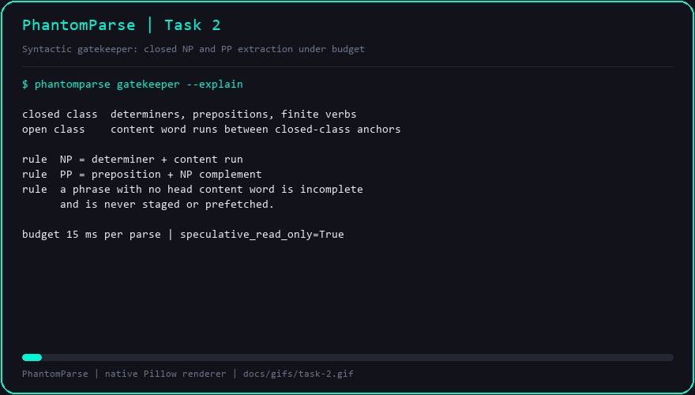

# Task 2 — Local Syntactic Gatekeeper (NP / PP)

## Objective

Extract only **closed, syntactically complete constituents** from the committed
token stream, locally, in under 15 ms. Everything it emits is a read-only
speculation target, never a mutation of the user's text.

## The problem this solves

A streaming pipeline needs *units* it can retrieve against. Characters are too
fine-grained and whole prompts are too coarse. A **Noun Phrase (NP)** such as
`the Firebase auth middleware` and a **Prepositional Phrase (PP)** such as
`for the Firebase auth middleware` are the smallest spans that still carry a
retrievable meaning, and they map cleanly onto retrieval keys.

The gatekeeper therefore runs a shallow chunker: closed-class words (determiners,
prepositions, finite and imperative verbs) act as anchors, and open-class content
runs between them form phrases. A phrase with no head content word is *incomplete*
and is dropped, so a dangling `in the ` never reaches the staging buffer.

## Implementation

`src/phantomparse/gatekeeper.py`

| Element | Behaviour |
| --- | --- |
| `NP`, `PP` | Chunk kinds; `Chunk.is_phrase` is true for both |
| `Chunk(text, kind, start, end, head, speculative_read_only)` | One extracted constituent with exact character offsets |
| `GatekeeperResult(chunks, backend, latency_ms)` | Parse result; `within_budget` compares against `GATEKEEPER_BUDGET_MS = 15.0` |
| `SyntacticGatekeeper.parse` | Times one parse with `time.perf_counter()` and returns the result |
| `SyntacticGatekeeper.chunks_of_kind` | Convenience filter used by benchmarks and the GIF recorder |
| `default_gatekeeper` / `chunk_text` | Process-wide singleton and a one-shot helper |

Two backends:

1. **SpaCy** (`en_core_web_sm`), used when the model is importable. Phrase spans
   come from the dependency parse and the POS tags.
2. **Rule-based fallback**, always available and fully deterministic. It uses
   the closed-class lexicons `DETERMINERS`, `PREPOSITIONS` and `BOUNDARY_WORDS`
   plus the token regex `[A-Za-z0-9][A-Za-z0-9'\-]*|[.,;:!?]`.

The fallback is what the test suite and this machine exercise, which is exactly
the guarantee Phase 1 needs: no model download, no cloud key, no network, and a
reproducible parse on every platform.

## What it extracts

Input `Compare the attention sink mechanism in StreamingLLM with PagedAttention in vLLM`:

| Kind | Text | Head |
| --- | --- | --- |
| NP | `the attention sink mechanism` | `mechanism` |
| PP | `in StreamingLLM` | `in` |
| PP | `with PagedAttention` | `with` |
| PP | `in vLLM` | `in` |

Input `in the ` (mid-typing) returns `[]`: the preposition has no content
complement yet, so nothing is staged.

Measured parse latency on this machine: **0.018–0.034 ms**, roughly 400× inside
the 15 ms budget.

## Demo



Regenerate with `python benchmarks/gif_recorder.py --task 2`.

The animation types the linear scenario through the Task 1 buffer and re-parses
the committed prefix as phrases close. Each frame shows the live stream, the
chunk count, and every NP / PP with its head word; the final frame reports
`within_budget=yes`.

## Verification gates

```text
$ python -m pytest tests/ -q
........................................................                 [100%]
56 passed in 0.46s

$ python -m flake8 --jobs 1 src/ tests/ benchmarks/
(no output)

$ python benchmarks/run_bench.py
## Syntactic Gatekeeper

Backend: `rules` | parse budget: 15 ms (best of 5 parses) | all chunks are `speculative_read_only=True`

| Scenario | Backend | Chunks | NP | PP | Parse Latency (ms) | Within Budget |
| --- | --- | ---: | ---: | ---: | ---: | :---: |
| linear | rules | 3 | 1 | 2 | 0.034 | yes |
| pivot | rules | 2 | 1 | 1 | 0.018 | yes |
| multi_clause | rules | 4 | 1 | 3 | 0.023 | yes |
```

## Commits

| Commit | Message |
| --- | --- |
| `29de3a9` | `feat: add local NP and PP syntactic gatekeeper with rule-based fallback` |
| `7ecd1df` | `feat: tag chunks read-only and measure parse latency against budget` |
| `0aaa31a` | `test: cover NP and PP extraction, read-only tagging and parse budget` |
| `3ac8f8c` | `bench: report gatekeeper constituents and render task 2 GIF` |

## Notes

- `text[start:end] == chunk.text` holds for every chunk, so a caller can slice
  the original prompt without rebuilding it.
- Terminal punctuation is excluded from spans; the tokenizer treats it as an
  anchor, not content.
- The SpaCy path is guarded by `_load_spacy()` and marked `pragma: no cover`
  because the model is optional by design. The rule backend is the contract.
- The gatekeeper is stateless with respect to the buffer: callers pass committed
  text only, which keeps speculative parsing away from half-typed words.
