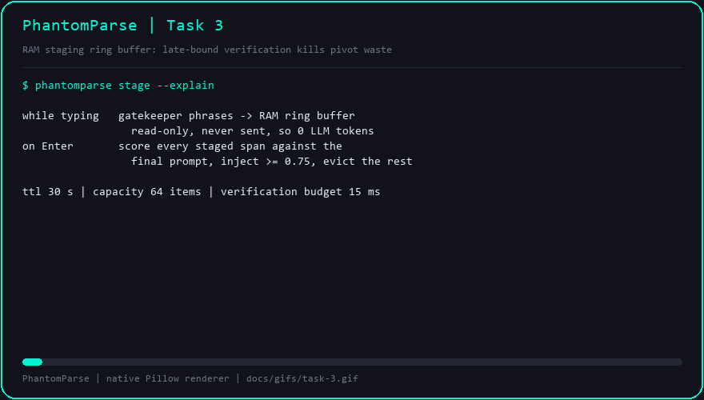

# Task 3 — RAM Staging Ring Buffer with Late-Bound Verification

## Objective

Hold prefetched context in RAM while the user types — spending **0 LLM tokens** —
and decide on `Enter` which staged spans actually belong in the final prompt.
Abandoned spans are evicted locally, so a mid-sentence pivot wastes nothing.

## The problem this solves

Speculation is only free if it is *late-bound*. The naive approach streams typed
prefixes to the model as they appear, which is why it reaches a low **TTFT (Time
to First Token)** but burns paid tokens on every draft the user deletes. Task 1
gave us clean word boundaries and Task 2 gave us closed **NP (Noun Phrase)** and
**PP (Prepositional Phrase)** spans. Task 3 is the piece that keeps those spans
on the machine until the prompt is final.

Two properties make the design safe:

1. **Read-only staging.** A staged span is a retrieval key plus a text payload,
   never a mutation of the user's buffer. `StagedItem.speculative_read_only` is
   `True` by construction.
2. **Late-bound verification.** Nothing is injected until the final prompt has
   been compared against every live span with a local scorer. The scorer is
   character n-gram based, so it needs no model download and no network.

## Implementation

`src/phantomparse/staging.py`

| Element | Behaviour |
| --- | --- |
| `StagedItem` | `item_id`, `text`, `kind`, `source`, `created_at`, `ttl_seconds`, `speculative_read_only`; `expires_at` / `is_expired(now)` |
| `ScoredItem` | A staged item plus its `score` and `accepted` verdict |
| `VerificationResult` | `scored`, `accepted`, `rejected`, `accepted_text`, `max_score`, `latency_ms`, `within_budget` |
| `StagingBuffer.stage` | Stage one span; blanks ignored, duplicates (after normalisation) returned as-is |
| `StagingBuffer.stage_chunks` | Stage every chunk from a `GatekeeperResult`; returns the count of *new* items |
| `StagingBuffer.purge_expired` | Drop spans whose **TTL (Time to Live)** elapsed |
| `StagingBuffer.snapshot` | Stable copy of live items for the daemon and the overlay |
| `StagingBuffer.verify` | Score every live item, keep survivors, evict losers, time itself |
| `StagingBuffer.stats` | `staged`, `expired`, `evicted_capacity`, `evicted_verification`, `live` |

Bounded ring buffer semantics: a `collections.deque` with `max_items` (default
`64`); overflow pops the oldest span and increments `evicted_capacity`. All
mutations run under a single `threading.RLock`, so the gatekeeper thread and the
UI thread can stage concurrently.

Defaults: `DEFAULT_TTL_SECONDS = 30.0`, `DEFAULT_MAX_ITEMS = 64`,
`DEFAULT_SIMILARITY_THRESHOLD = 0.75`, `VERIFICATION_BUDGET_MS = 15.0`. The
clock is injected (`clock: Callable[[], float]`), which is what lets the tests
advance time instead of sleeping.

### The similarity function

Character-trigram cosine alone is length sensitive: a phrase that appears
verbatim inside a long prompt still scores low, because the prompt contributes
many extra grams to the dot product's normaliser. The fix is to take the maximum
of two views:

- **cosine** over sublinear term-frequency weighted trigrams (`1 + log count`),
- **containment**: the fraction of the *staged span's* trigrams present in the
  prompt.

Containment is 1.0 for a verbatim span, which is exactly the property the
verifier needs. Measured on the pivot scenario:

| Staged span | Score vs final prompt |
| --- | ---: |
| `a unit test` | 1.00 |
| `for the Firebase auth middleware` | 1.00 |
| `the payment failure logs` | 0.21 |
| `in Razorpay` | 0.00 |

The 0.75 threshold separates them cleanly.

## What the pivot test proves

`tests/test_staging.py::test_mid_sentence_pivot_yields_zero_wasted_tokens`
replays the pivot scenario end to end — `KeystrokeBuffer` → rule-based
`SyntacticGatekeeper` → `StagingBuffer` — and asserts:

- the abandoned clause *was* staged locally (so the prefetch really happened),
- every rejected span scores strictly below the threshold,
- every accepted span is a verbatim substring of the normalised final prompt,
- the set of wasted spans is empty.

The test suite also covers TTL expiry on a fake clock, capacity eviction,
duplicate suppression, threshold override, the 15 ms verification budget across
25 runs, and 400 concurrent stagings from 8 threads.

## Demo



Regenerate with `python benchmarks/gif_recorder.py --task 3`.

The animation replays the pivot scenario: it types `Check the payment failure
logs in Razorpay`, stages the NPs as phrases close, holds them through the
400 ms pause, rolls them back on the backspaces (purple frames, still staged),
then types the new clause. The verification frame lists every span with its
score and an `inject` / `evict` verdict; the final frame reports
`staged=8 injected=5 evicted=3` and `wasted LLM tokens = 0`.

## Verification gates

```text
$ python -m pytest tests/ -q
........................................................................ [ 92%]
......                                                                   [100%]
78 passed in 0.70s

$ python -m flake8 --jobs 1 src/ tests/ benchmarks/
(no output)

$ python benchmarks/run_bench.py
| PhantomParse | linear | 101.1 | 1.8 | 0 | 0.0 | 0.06 |
| PhantomParse | pivot | 101.7 | 2.4 | 0 | 0.0 | 0.03 |
| PhantomParse | multi_clause | 101.4 | 2.0 | 0 | 0.0 | 0.03 |

| PhantomParse | 101.4 | 2.1 | 0 | 0.0 | 87.2% | 0.06 |

## Late-Bound Verification

| Scenario | Staged | Injected | Evicted (pivot) | Max Score | Wasted LLM Tokens |
| --- | ---: | ---: | ---: | ---: | ---: |
| linear | 6 | 6 | 0 | 1.00 | 0 |
| pivot | 8 | 5 | 3 | 1.00 | 0 |
| multi_clause | 6 | 6 | 0 | 1.00 | 0 |
```

PhantomParse mean TTFT is **101.4 ms** against a **795.0 ms** baseline
(87.2% reduction) with **0 wasted tokens**, versus 10 wasted tokens (13.9%) for
naive speculation on the same scenarios. Peak traced pipeline memory is
**0.06 MB**, far inside the 50 MB budget.

## Commits

| Commit | Message |
| --- | --- |
| `5ac0cf6` | `feat: add thread-safe RAM staging ring buffer with TTL and capacity limits` |
| `39c22d5` | `feat: verify staged spans with late-bound character n-gram scoring` |
| `2d62597` | `test: prove the mid-sentence pivot injects zero wasted tokens` |
| `4127d4c` | `bench: report late-bound verification and render task 3 GIF` |

## Notes

- `verify` mutates the buffer by design: rejection is eviction. Callers that want
  to inspect without evicting can read `snapshot()` first.
- Verification latency is measured with `time.perf_counter()` inside the same
  lock hold, so the reported number includes contention.
- Containment is directional — it asks "is this span inside the prompt?", not
  "is the prompt inside this span?" — which is why a long unrelated prompt does
  not accidentally accept a short abandoned span.
- Token accounting for the benchmark stays conservative: only injected spans
  contribute to `total_tokens`, and rejected spans contribute nothing because
  they were never sent anywhere.
