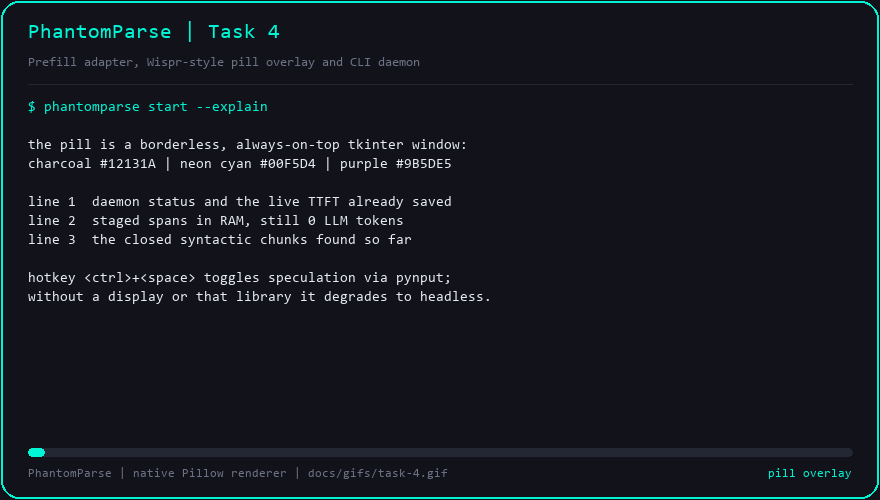

# Task 4 — Prefill Adapter, Wispr-Style Pill Overlay and CLI Daemon

## Objective

Turn the local pipeline built in Tasks 1–3 into something a user can actually
run: a background daemon that watches keystrokes, stages closed phrases in RAM,
warms the model's **KV (Key-Value)** cache for free, shows a floating overlay
pill, and answers instantly on `Enter` — while still wasting **0 LLM tokens**
when the user changes their mind.

## The problem this solves

Tasks 1–3 proved the mechanics in isolation. Task 4 closes the loop:

- **Prefill adapter.** Warm the inference server with the staged context during
  typing, so the prompt's prefix is already in the KV cache when the user
  presses `Enter`. If the user backspaces into a warmed prefix, the cache is
  truncated at the exact character that changed.
- **Overlay pill.** A borderless, always-on-top window that shows what the
  daemon is doing — without stealing focus or pushing the user's typing around.
- **Daemon.** The state machine that wires buffer → gatekeeper → staging →
  prefill → overlay, plus the hotkey that arms and pauses speculation.
- **CLI.** `phantomparse start | overlay | bench | config`, including a headless
  demo mode that works with no display and no model server.

## Implementation

### `src/phantomparse/prefill_adapter.py`

| Element | Behaviour |
| --- | --- |
| `estimate_tokens` | `ceil(words * 1.35)`, `0` for blank text |
| `PrefillAdapter.backend` | `auto` probes `GET /api/tags` once; explicit `http`/`emulator` never probes |
| `PrefillAdapter.warm` | `POST {endpoint}/api/generate` with `num_predict: 1` and `temperature: 0.0` — one token in, prompt cached |
| `PrefillAdapter.truncate` | Cuts the cached text at a character index and re-accounts tokens |
| `PrefillAdapter.saved_ttft_ms` | `0.0` before any warm, else `RETRIEVAL_BASE_MS + cached_tokens / rate * 1000` |
| `PrefillOutcome` | `text`, `tokens`, `cached_tokens`, `latency_ms`, `backend`, `truncated_tokens` |

Backend policy: `auto` → HTTP if the endpoint answers the probe, otherwise the
deterministic emulator. A failed HTTP warm demotes the adapter for the rest of
the session instead of retrying on every keystroke. The 0.25 s probe and 0.5 s
request timeouts mean an unreachable server costs at most one short stall.

### `src/phantomparse/overlay.py`

| Element | Behaviour |
| --- | --- |
| `OverlayState` | `committed`, `chunks`, `staged`, `injected`, `ttft_saved_ms`, `status` |
| `pill_lines` | Three lines, each fit to a character width: status, counters, chunk preview |
| `Overlay` | `tkinter` `Toplevel` with `overrideredirect(True)` and `-topmost`; bottom-centred; `Escape` closes |
| `Overlay.open` / `pump` | Build the window without `mainloop`, then repaint once per keystroke |
| `tkinter_available()` | Probes a real `Tk()` and destroys it — no false positives on headless CI |

Palette: charcoal `#12131A`, neon cyan `#00F5D4`, purple `#9B5DE5`, text
`#E6EAF2`, dim `#6C7285`. Savings are printed right-aligned in the pill, the
status dot is purple, and long chunk previews are left-truncated with `...` so
the *end* of the phrase (the part that just closed) stays visible.

### `src/phantomparse/daemon.py`

| Element | Behaviour |
| --- | --- |
| `Daemon.feed_char` / `feed_text` / `feed_backspace` | Drive the buffer, stage on closed phrases, truncate the KV cache on rollback |
| `Daemon.submit` | Flush → verify → `maximal_spans` → warm → report → reset |
| `SubmitResult` | `prompt`, `verification`, `injected_spans`, `injected_tokens`, `prefill_latency_ms`, `wasted_tokens`, `ttft_saved_ms` |
| `maximal_spans` | Deduplicates spans and drops any span contained in a longer accepted span |
| `Daemon.refresh` | Recomputes `OverlayState` from live counters |
| `Daemon.install_hotkey` | `pynput` `<ctrl>+<space>` toggle, else headless fallback |
| `demo_states` | Deterministic frame sequence for the demo and the GIF |

`maximal_spans` matters because staging grows a phrase as it closes: `"a unit"`
is staged, then `"a unit test"` supersedes it. Verification legitimately accepts
both (the shorter one is a verbatim substring), but injecting both would send
duplicate context. Collapsing to maximal spans keeps the warm payload and the
reported token count honest — the pivot scenario goes from 5 accepted spans to
**2 injected spans**.

### `src/phantomparse/cli.py`

```
phantomparse start   [--config PATH] [--headless] [--no-hotkey] [--demo] [--scenario KEY]
phantomparse overlay [--demo] [--headless] [--scenario KEY] [--step N] [--interval-ms N]
phantomparse bench   [--config PATH] [--modes ...] [--scenarios ...]
phantomparse config  [--path PATH] [--init] [--set KEY=VALUE ...]
```

`_read_key` uses `msvcrt.getwch()` on Windows and `termios` elsewhere, maps
`\r\n` to `\n`, `\x08\x7f` to `\b`, and returns `None` for `Esc`/`Ctrl-C`/EOF.
`--demo` replays the pivot scenario without a keyboard. `config --set` validates
keys against `Config().to_dict()` and exits `2` on an unknown key, so a typo can
never silently write a broken config.

## What the end-to-end test proves

`tests/test_e2e_pipeline.py` drives the bundled keystroke timeline through the
whole daemon and asserts, for the pivot scenario:

- the abandoned clause is staged locally but never injected,
- `injected_spans == ("a unit test", "for the Firebase auth middleware")`,
- every injected span appears verbatim in the final prompt,
- `Razorpay`, `payment`, `logs` never reach the model,
- wasted tokens are `0`, verification stays inside the 15 ms budget,
- `ttft_saved_ms >= 420` and prefill latency is smaller than the time saved,
- peak traced memory stays under the configured `max_ram_mb`.

## Demo



Regenerate with `python benchmarks/gif_recorder.py --task 4`.

30 frames, 541.5 KiB, Pillow-only. The animation introduces the palette and the
three pill lines, then replays the pivot: typing with the pill reading `armed`,
the purple pivot pause with abandoned spans still in RAM, purple `kv truncate`
frames for each invalidating backspace, the verification table listing every
span's score with an `inject` / `merge` / `evict` verdict, and a final frame
reporting `injected=2 spans | 11 tokens | 45.8 ms prefill`,
`evicted=3 abandoned pivot spans | never sent`, `saved=466 ms of TTFT |
wasted=0 tokens`. `merge` marks prefixes that verification accepted but that
`maximal_spans` folded into a longer span.

## Verification gates

```text
$ python -m pytest tests/ -q
........................................................................ [ 55%]
..........................................................                [100%]
130 passed in 1.49s

$ python -m flake8 --jobs 1 src/ tests/ benchmarks/
(no output)
```

```text
$ python benchmarks/run_bench.py

| Mode | Scenario | TTFT (ms) | Post-Enter Retrieval (ms) | Wasted LLM Tokens | Token Waste (%) | Peak Daemon Memory (MB) |
| --- | --- | ---: | ---: | ---: | ---: | ---: |
| Baseline | linear | 810.3 | 479.5 | 0 | 0.0 | 0.00 |
| Baseline | pivot | 779.7 | 465.5 | 0 | 0.0 | 0.00 |
| Baseline | multi_clause | 795.0 | 472.5 | 0 | 0.0 | 0.00 |
| Naive Speculation | linear | 183.0 | 25.0 | 0 | 0.0 | 0.00 |
| Naive Speculation | pivot | 183.0 | 25.0 | 10 | 41.7 | 0.00 |
| Naive Speculation | multi_clause | 183.0 | 25.0 | 0 | 0.0 | 0.00 |
| PhantomParse | linear | 101.4 | 2.0 | 0 | 0.0 | 0.06 |
| PhantomParse | pivot | 101.1 | 1.8 | 0 | 0.0 | 0.03 |
| PhantomParse | multi_clause | 101.3 | 2.0 | 0 | 0.0 | 0.03 |

| Mode | Mean TTFT (ms) | Mean Post-Enter Retrieval (ms) | Wasted LLM Tokens | Mean Waste (%) | TTFT Reduction vs Baseline | Peak Memory (MB) |
| --- | ---: | ---: | ---: | ---: | ---: | ---: |
| Baseline | 795.0 | 472.5 | 0 | 0.0 | n/a | 0.00 |
| Naive Speculation | 183.0 | 25.0 | 10 | 13.9 | 77.0% | 0.00 |
| PhantomParse | 101.3 | 1.9 | 0 | 0.0 | 87.3% | 0.06 |

## Late-Bound Verification

| Scenario | Staged | Injected | Evicted (pivot) | Max Score | Wasted LLM Tokens |
| --- | ---: | ---: | ---: | ---: | ---: |
| linear | 6 | 3 | 0 | 1.00 | 0 |
| pivot | 8 | 2 | 3 | 1.00 | 0 |
| multi_clause | 6 | 4 | 0 | 1.00 | 0 |
```

PhantomParse mean TTFT is **101.3 ms** against a **795.0 ms** baseline
(87.3% reduction) with **0 wasted tokens**, versus 10 wasted tokens (13.9%) for
naive speculation. Peak traced pipeline memory is **0.06 MB**.

## Commits

| Commit | Message |
| --- | --- |
| `c4733d3` | `feat: add incremental prefill adapter with KV prefix truncation` |
| `760714b` | `feat: add synthwave pill overlay and speculative daemon with hotkey fallback` |
| `3cafe52` | `feat: add phantomparse CLI with start, overlay, bench and config commands` |
| `9f1bcc9` | `fix: honor an explicit prefill backend without probing the endpoint` |
| `bc69bd0` | `fix: collapse nested accepted spans into one maximal context` |
| `fe1fd57` | `test: cover the overlay pill and the end-to-end pivot pipeline` |
| `2a1e8b6` | `fix: report maximal injected spans in the benchmark report` |
| `e5c085d` | `docs: render the task 4 overlay and daemon gif` |

## Notes

- No model server is required for tests or the demo: the emulator backend
  derives `tokens / prefill_tokens_per_second` deterministically, so latency
  assertions are stable on any machine.
- `truncate` is character-indexed rather than token-indexed because the buffer
  knows exactly which character the user deleted; rounding to a token boundary
  would keep stale context alive.
- The overlay runs on the main thread and repaints from `pump()`; the daemon
  never calls `mainloop`, so the CLI stays responsive to keystrokes.
- Hotkey support uses `pynput` when it is importable and a real display exists;
  otherwise the daemon reports `headless` and the CLI drives it from stdin.
